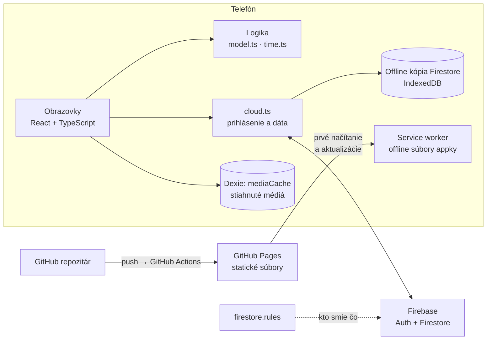
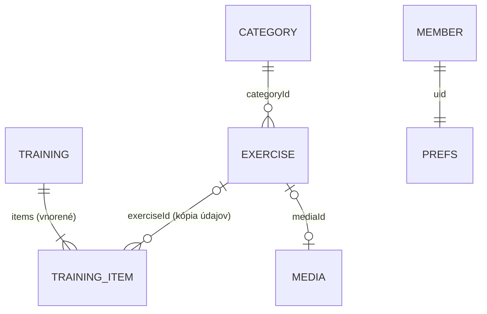

# DESIGN – Karate Training Planner

Dokument popisuje, **ako** je aplikácia postavená v aktuálnej verzii 2. Verzia 1 (MVP zo `SPEC.md`) mala všetky dáta iba v telefóne v IndexedDB. Verzia 2 doplnila prihlasovanie, spoločné dáta vo Firebase, časomieru a časti tréningu (`SPEC.md`, kap. 9). Rozdiely oproti verzii 1 sú v kap. 8.

## 1. Architektúra

Aplikácia je **webová aplikácia nainštalovateľná na plochu** (PWA). Obrazovky a výpočty bežia v telefóne. Spoločné dáta sú vo **Firebase** (Authentication + Firestore) a telefón má ich offline kópiu. Vlastný server ani serverový kód nemá. GitHub slúži na uloženie kódu a zverejnenie statických súborov.

- **Obrazovky** (`src/pages/`) zobrazujú dáta a s databázou pracujú iba cez funkcie z `cloud.ts`.
- **`cloud.ts`** je jediné miesto, ktoré pracuje s Firebase: prihlásenie, počúvanie zmien, zápisy, médiá a predvolené dáta.
- **`model.ts`** obsahuje dátové typy a čisté pomocné funkcie, **`time.ts`** všetky výpočty času vrátane fáz časomiery. Nezávisia od obrazoviek ani od Firebase.
- **Firestore** drží kópiu dát v telefóne (IndexedDB), takže appka funguje bez internetu a zmeny odošle neskôr.
- **Service worker** uloží všetky súbory aplikácie vrátane predvolených obrázkov (3.2).

## 2. Technológie

| Oblasť | Voľba | Prečo |
| --- | --- | --- |
| Jazyk a UI | TypeScript, React 19 | typová kontrola dát, komponenty pre opakujúce sa časti |
| Build | Vite 8 | rýchly vývojový server, jednoduché zostavenie statických súborov |
| Navigácia | React Router, `HashRouter` | adresy typu `#/trainings/3` fungujú na GitHub Pages bez nastavenia servera |
| Prihlásenie | Firebase Authentication (e-mail/heslo odvodené z kľúča) | tréner nezadáva e-mail ani heslo, len meno a kľúč |
| Dáta | Firebase Firestore s `persistentLocalCache` | zdieľanie medzi trénermi, offline kópia, zadarmo v pláne Spark |
| Cache médií, staré dáta | IndexedDB cez Dexie.js | stiahnuté obrázky a videá ostanú v telefóne; dáta verzie 1 sa presunú do Firebase |
| Posúvanie | dnd-kit (`core`, `sortable`, `modifiers`) | posúvanie prstom na iPhone cez úchyt ⠿ |
| Zvuk a obrazovka | Web Audio API, Wake Lock API | pípanie časomiery bez zvukových súborov, displej nezhasne počas časomiery |
| PWA | vite-plugin-pwa (Workbox) | manifest, ikona, offline cache a automatické aktualizácie |
| Hosting | GitHub Pages + GitHub Actions | zadarmo, zverejnenie po každom push do `main` |

## 3. Dátový model (Firestore)

| Kolekcia | Obsah | Kto číta / zapisuje |
| --- | --- | --- |
| `config/access` | `keys`, `adminKeys` – zoznamy prihlasovacích kľúčov | nikto z appky; nastavuje správca vo Firebase konzole |
| `members/{uid}` | `name`, `key`, `admin` | len daný tréner |
| `prefs/{uid}` | `favorites`, `hidden`, `order`, `timeOnly` – osobné nastavenia | len daný tréner |
| `categories` | `name`, `order`, `timeOnly`, `private`, `starterKey`, autor | všetci tréneri; súkromné len autor |
| `exercises` | `name`, `description`, `categoryId`, `order`, Timing, `mediaId` / `mediaFile`, `isDefault`, `byAdmin`, `private`, autor | všetci; mení autor alebo správca |
| `trainings` | `name`, `description`, `date`, `startTime`, `tag`, `group`, `items`, `warmupSeconds`, `cooldownSeconds`, `done`, `doneAt`, `coach`, `private`, autor | všetci; mení autor alebo správca |
| `trainingTypes` | vlastné typy tréningov | všetci |
| `appSettings/global` | `removedStarter` – predvolené položky, ktoré správca vymazal | číta každý, zapisuje správca |
| `media/{id}/chunks/{n}` | obrázok alebo video rozdelené na kúsky po 900 kB | všetci; maže autor alebo správca |

Autor = `createdBy` (uid) a `createdByName` (meno). Predvolené položky majú `createdBy = 'starter'`.

**Timing** (cvik aj položka tréningu): `mode` (`reps` / `time`), `sets`, `reps`, `secondsPerRep`, `workSeconds`, `restBetweenSets`, voliteľne `switchEvery`, `switchSeconds` (výmena počas série) a `atoshi`.

**TrainingItem** = Timing + `exerciseId`, `name` (kópia názvu), `restAfter`, `timeOnly`, `section` (`warmup` / `main` / `cooldown`).

**Prečo kópia údajov v tréningu:** časy sa dajú v tréningu zmeniť bez zmeny cviku. Tréning ostane čitateľný, aj keď sa cvik premenuje alebo vymaže.

**Lokálna databáza Dexie** (`src/db.ts`) má verzie 1–3 z verzie 1 aplikácie (cviky, tréningy v telefóne) a verziu 4 s tabuľkou `mediaCache`. Existujúce verzie sa nemenia, každá zmena je nová verzia s vlastným `upgrade()`.

## 4. Prihlásenie a prístup

1. Tréner zadá meno a kľúč. Appka z kľúča vytvorí e-mail `k<hash>@karatetrener.app` a heslo = kľúč a prihlási sa (prvýkrát účet vytvorí).
2. Zapíše `members/{uid}` s menom a kľúčom. Pravidlá overia, že kľúč je v `config/access.keys`, resp. `adminKeys` pre správcu.
3. Prihlásený tréner sa zapamätá v `localStorage`, appka sa preto otvorí hneď, aj offline. Odhlásenie vymaže kópiu dát v telefóne.
4. Ak správca kľúč zo zoznamu vymaže, pravidlá trénerovi odmietnu `prefs` a appka ho odhlási.

Pravidlá prístupu sú v `firestore.rules` a musia zodpovedať funkciám v `cloud.ts` (po zmene ich treba znova zverejniť, pozri `FIREBASE.md`).

| Akcia | Tréner | Správca |
| --- | --- | --- |
| vidieť verejné cviky, kategórie, tréningy | áno | áno |
| vidieť súkromné (🔒) | len svoje | len svoje |
| upraviť / vymazať cvik, kategóriu, tréning | len svoje | všetky, aj predvolené |
| poradie, „Len na čas“ | len pre seba (`prefs`) | pre všetkých (pole v dokumente) |
| obľúbené, skryté | pre seba | pre seba |
| pridať typ tréningu | áno, pre všetkých | áno |

## 5. Predvolené dáta a médiá

Predvolené kategórie a cviky sú v `src/starterData.ts`, ich obrázky a videá v `public/exercises/`. Funkcia `syncStarterData()` beží po prihlásení, keď prídu dáta zo servera:

1. Chýbajúcu predvolenú kategóriu alebo cvik pridá s pevným id (`s-c-…`, `s-e-…`), takže z dvoch telefónov nevzniknú duplikáty.
2. Položky, ktoré správca vymazal (`appSettings/global.removedStarter`), znova nepridá.
3. Nemení údaje, ktoré už niekto upravil.

**Nahrané médiá:** obrázok sa pred nahraním zmenší, video sa nahrá celé (najviac 40 MB). Súbor sa rozdelí na kúsky po 900 kB do `media/{id}/chunks`, lebo Firebase Storage by vyžadoval platený plán. Stiahnuté médium sa uloží do `mediaCache`, každý telefón ho sťahuje iba raz.

**Ktoré médium sa zobrazí:** nahrané (`mediaId`), potom súbor z `public/exercises/` (`mediaFile`), inak prvé písmeno názvu. Video sa prehráva dokola bez zvuku, ak to tréner nevypol v Nastaveniach.

**Šablóna tréningu** je v `src/trainingTemplate.ts` (názvy cvikov rozcvičky a záveru, dĺžky častí). Úprava sa dostane ku všetkým trénerom s ďalším nasadením.

## 6. Rozhranie modulov (interné API)

### `src/cloud.ts`

| Funkcia | Účel |
| --- | --- |
| `login`, `logout`, `rename`, `useSession` | prihlásenie, odhlásenie, zmena mena, stav prihlásenia |
| `useData` | kategórie, cviky, tréningy a typy spojené s osobnými nastaveniami trénera |
| `isAdmin`, `isMine`, `canEditExercise`, `canDeleteExercise`, `canEditTraining`, `canDeleteCategory` | kto smie čo (zodpovedá `firestore.rules`) |
| `saveExercise`, `deleteExercise`, `saveTraining`, `updateTraining`, `deleteTraining` | zápis a mazanie |
| `addCategory`, `deleteCategory`, `setCategoryPrivate`, `setCategoryTimeOnly`, `addTrainingType` | kategórie a typy |
| `setFavorite`, `setHidden`, `saveOrder` | osobné nastavenia; poradie správcu pre všetkých |
| `useMediaBlob`, `showError`, `useError` | načítanie média, chybové hlásenia |

### `src/time.ts`

| Funkcia | Účel |
| --- | --- |
| `workPerSet`, `setParts`, `setSeconds`, `itemSeconds` | čas série (aj s výmenou) a cviku |
| `trainingSeconds`, `schedule`, `sectionItems`, `trainingPlan` | dĺžka a rozvrh tréningu po častiach |
| `clockAt`, `formatDuration`, `parseDuration`, `formatDate`, `timingSummary`, `exerciseCount` | zobrazenie a zadávanie času, slovenské texty |
| `customTimerPhases`, `trainingTimerPhases`, `timerSetCount`, `timerTotalSeconds` | fázy časomiery (príprava, cvik, výmena, pauza) |

Ostatné: `model.ts` (typy, typy tréningov a farby, skupiny a ich čas začiatku, triedenie), `settings.ts` (nastavenia v telefóne), `beep.ts` (zvuky), `confirm.tsx` (potvrdzovacie okno), `sortable.tsx` (posúvanie).

## 7. Pravidlá výpočtov a správania

| Pravidlo | Návrh |
| --- | --- |
| Práca v sérii | `time`: `workSeconds`; `reps`: `reps × secondsPerRep` |
| Výmena počas série | séria sa rozdelí na časti po `switchEvery` s, medzi nimi `switchSeconds` na výmenu; čas série = práca + výmeny |
| Čas cviku | `sets × séria + (sets − 1) × restBetweenSets + restAfter`; pri poslednom cviku bez `restAfter` (K9, K11) |
| Rozvrh | začiatok cviku = koniec predchádzajúceho + jeho `restAfter`; časti tréningu idú za sebou: rozcvička, hlavná časť, záver (K10) |
| Časomiera | časy podľa `Date.now()`, nie podľa počtu tikov, takže nezaostáva; 3-2-1 krátke pípnutia okrem výmeny, dlhé pípnutie pri zmene fázy, atoshi 15 s pred koncom časti dlhšej ako 15 s |
| Zoznam cvikov | obľúbené hore, potom poradie; v pohľade „Všetky“ najviac 7 na kategóriu (K4, K5) |
| Režim usporiadania (⇅) | iba podľa poradia, aby posúvanie zodpovedalo uloženému poradiu |
| Skrytie a mazanie | skrytie je osobné; mazanie len autor alebo správca, s potvrdením v appke (K6, K14) |
| Kategória „len na čas“ | bez prepínača Opakovania/Čas, cviky sa prepočítajú na čas (K8) |
| Nový tréning | šablóna alebo kópia; čas začiatku podľa skupiny (Prípravka 16:30, Starší 17:00) |
| Médium z aplikácie | najviac 40 MB (K3) |

## 8. Obrazovky a navigácia

| Adresa | Obrazovka |
| --- | --- |
| prihlásenie | meno a prihlasovací kľúč (bez prihlásenia sa iná obrazovka nezobrazí) |
| `#/exercises` | Cviky – hľadanie, kategórie, obľúbené, skryté, usporiadanie, cviky iných trénerov |
| `#/exercises/new`, `#/exercises/:id/edit` | Nový / úprava cviku |
| `#/exercises/:id` | Detail cviku, autor, hviezdička, skryť, vymazať |
| `#/categories` | Poradie kategórií, „Len na čas“, súkromná, vymazanie |
| `#/timer` | Časomiera – vlastná alebo podľa tréningu (`#/timer?training=id`) |
| `#/trainings` | Tréningy – filtre, zoradenie, skryté, usporiadanie |
| `#/trainings/new`, `#/trainings/:id/edit` | Nový / úprava tréningu, časti, výber cvikov, časy, kópia |
| `#/trainings/:id` | Detail tréningu – rozvrh po častiach, odtrénovaný, spustenie časomiery |
| `#/settings` | Účet (meno, odhlásenie), automatické prehrávanie videí, odkaz na kategórie |

Spodná lišta: **Cviky / Časomiera / Tréningy**. Formuláre majú hornú lištu so Späť. Hlavné obrazovky majú logo klubu a podpis autorky (3.5).

## 9. Rozhodnutia a alternatívy

| Rozhodnutie | Zvažované alternatívy | Prečo takto |
| --- | --- | --- |
| PWA | natívna aplikácia (Swift), React Native s Expo | bez Macu a plateného účtu sa natívna appka nedá trvalo nainštalovať |
| v1: dáta iba v telefóne | Firebase | verzia 1 nepotrebovala účty ani zdieľanie |
| v2: Firebase Firestore | vlastný server | zadarmo, bez servera, vstavaná offline kópia a živé zmeny |
| Prihlásenie menom a kľúčom | e-mail a heslo, Google účet | tréneri nemusia nič zakladať, správca prístup pridá aj zruší jedným kľúčom |
| Médiá v kúskoch vo Firestore | Firebase Storage | Storage vyžaduje plán Blaze s platobnou kartou |
| Predvolené médiá v `public/exercises/` | nahrať ich do databázy | nezaberajú miesto v bezplatnom pláne, aktualizujú sa s novou verziou appky |
| Osobné nastavenia v `prefs/{uid}` | spoločné poradie pre všetkých | každý tréner si usporiada cviky po svojom, správca určí predvolené poradie |
| Kópia cviku v tréningu | iba odkaz na cvik | časy sa dajú upraviť v tréningu a tréning ostane platný aj po zmene cviku |
| Potvrdenia v appke (`confirm.tsx`) | `window.confirm` | niektoré prehliadače zabudované v aplikáciách systémové okno potlačia |
| `HashRouter` | `BrowserRouter` | GitHub Pages nevie presmerovať ostatné adresy na `index.html` |

## 10. Riziká

| Riziko | Dopad | Opatrenie |
| --- | --- | --- |
| Únik prihlasovacieho kľúča | cudzí človek vidí a mení dáta klubu | kľúč odstrániť z `config/access`, kľúče aspoň 6 znakov a ťažko uhádnuteľné |
| Limity bezplatného plánu (1 GB, 50 000 čítaní/deň) | appka prestane načítavať dáta | krátke videá, médiá v cache telefónu, offline kópia |
| `firestore.rules` nezverejnené po zmene | zápisy zlyhajú s chybou oprávnenia | po každej zmene pravidiel Publish (`FIREBASE.md`); appka ukáže chybové hlásenie |
| Duplicitné cviky po presune zo staršej verzie | neprehľadný zoznam | presun prebehne iba raz; duplikáty vymaže autor alebo správca |
| iOS zmení správanie webových aplikácií (zvuk, offline) | horšia podpora časomiery alebo offline | testovať po aktualizáciách iOS podľa K15, K16, K24 |

## 11. Overenie

Hotová verzia sa overuje akceptačnými kritériami K1–K27 v `SPEC.md` na iPhone s aplikáciou nainštalovanou na ploche. Kontrola kódu pred každým push: `npm run typecheck`, `npm run lint` a `npm run build`.
