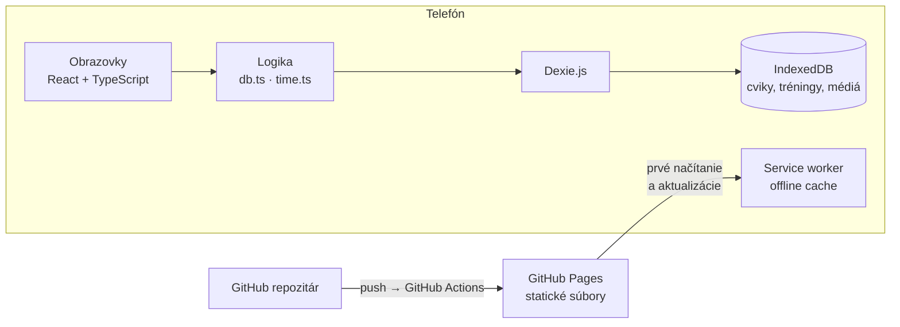
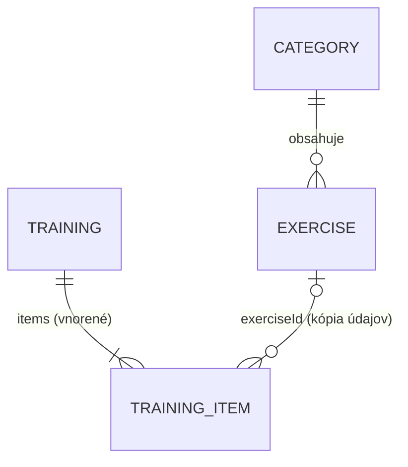

# DESIGN – Karate Training Planner

## 1. Architektúra

Aplikácia je **webová aplikácia nainštalovateľná na plochu**, ktorá beží celá v telefóne. Nemá server ani serverové API. GitHub slúži len na uloženie kódu a zverejnenie statických súborov.

- **Obrazovky** zobrazujú dáta a reagujú na používateľa. S databázou pracujú iba cez funkcie z `db.ts` a Dexie.
- **Logika** (`db.ts`, `time.ts`) obsahuje dátový model, migrácie, predvolené dáta a všetky výpočty času. Nezávisí od obrazoviek.
- **IndexedDB** je databáza prehliadača v telefóne. Ukladá aj fotky a videá ako súbory (Blob).
- **Service worker** uloží všetky súbory aplikácie vrátane predvolených obrázkov, takže aplikácia funguje offline (3.2).

## 2. Technológie

| Oblasť | Voľba | Prečo |
| --- | --- | --- |
| Jazyk a UI | TypeScript, React 19 | typová kontrola dát, komponenty pre opakujúce sa časti (riadok cviku, časové polia) |
| Build | Vite | rýchly vývojový server s okamžitým obnovením, jednoduché zostavenie statických súborov |
| Navigácia | React Router, `HashRouter` | adresy typu `#/trainings/3` fungujú na GitHub Pages bez nastavenia servera |
| Databáza | IndexedDB cez Dexie.js | uloží veľa dát aj súbory, funguje offline; Dexie pridáva verzie schémy, migrácie a živé dotazy (`useLiveQuery`) |
| Posúvanie | dnd-kit (`core`, `sortable`, `modifiers`) | posúvanie prstom na iPhone cez úchyt ⠿, podpora klávesnice |
| PWA | vite-plugin-pwa (Workbox) | manifest, ikona, offline cache a automatické aktualizácie |
| Hosting | GitHub Pages + GitHub Actions | zadarmo, zverejnenie po každom `git push` |

## 3. Dátový model

Databáza `karate-training-planner`, aktuálna **verzia schémy 2**. Tri tabuľky.

### 3.1 `categories` – kategórie cvikov

| Pole | Typ | Popis |
| --- | --- | --- |
| `id` | číslo, auto | primárny kľúč |
| `name` | text | názov, napr. „Údery – karate“ |
| `order` | číslo | poradie v zozname (index) |
| `timeOnly` | áno/nie | cviky sa zadávajú len na čas (1.10) |
| `starterKey` | text | názov z predvolených dát; prázdny pri vlastnej kategórii (index) |

### 3.2 `exercises` – cviky

| Pole | Typ | Popis |
| --- | --- | --- |
| `id` | číslo, auto | primárny kľúč |
| `name`, `description` | text | názov (index) a popis |
| `categoryId` | číslo | odkaz na kategóriu (index) |
| `order` | číslo | poradie v kategórii (index) |
| `mode` | `reps` / `time` | meria sa opakovaniami alebo časom |
| `sets`, `reps`, `secondsPerRep`, `workSeconds`, `restBetweenSets` | čísla | predvolené časy (blok **Timing**, pozri nižšie) |
| `favorite` | áno/nie | obľúbený, zobrazuje sa hore (1.7) |
| `hidden` | áno/nie | skrytý (1.8) |
| `media`, `mediaType` | súbor (Blob), `image` / `video` | fotka/video nahrané v aplikácii |
| `mediaFile` | text | názov súboru v `public/exercises/` pri predvolenom cviku |
| `customMedia` | áno/nie | tréner zmenil médium → predvolené dáta ho už neprepíšu |
| `starterKey` | text | `"Kategória/Názov"` pri predvolenom cviku (index) |
| `isDefault`, `createdAt` | áno/nie, čas | predvolený cvik, čas vytvorenia |

**Timing** (spoločný blok cviku aj položky tréningu): `mode`, `sets`, `reps`, `secondsPerRep`, `workSeconds` (čas jednej série pri `time`), `restBetweenSets`.

### 3.3 `trainings` – tréningy

| Pole | Typ | Popis |
| --- | --- | --- |
| `id` | číslo, auto | primárny kľúč |
| `name`, `description` | text | názov a popis |
| `date` | text `YYYY-MM-DD` | dátum (index) |
| `startTime` | text `HH:MM` | čas začiatku (2.5) |
| `tag` | text | typ tréningu zo zoznamu `TRAINING_TAGS` |
| `coach` | text | meno trénera |
| `items` | zoznam **TrainingItem** | cviky tréningu v poradí |
| `order` | číslo | poradie v zozname (index) |
| `hidden` | áno/nie | skrytý tréning |
| `done`, `doneAt` | áno/nie, čas | odtrénovaný a kedy (2.8) |
| `createdAt`, `updatedAt` | čas | vytvorenie a posledná úprava |

**TrainingItem** = Timing + `exerciseId`, `name` (kópia názvu), `restAfter` (prestávka pred ďalším cvikom v sekundách), `timeOnly`.

**Prečo kópia údajov v tréningu:** časy sa dajú v tréningu zmeniť bez zmeny cviku v databáze. Tréning ostane čitateľný, aj keď sa cvik neskôr premenuje, skryje alebo vymaže. `exerciseId` sa používa iba na zobrazenie obrázka.

### 3.4 Verzie schémy a migrácia

| Verzia | Obsah |
| --- | --- |
| 1 | základné tabuľky a indexy `order` (kategórie), `categoryId`, `name` (cviky), `date` (tréningy) |
| 2 | nové polia z 3.1–3.3 a indexy `starterKey` a `order` |

Upgrade 1 → 2 prebehne raz, pri prvom otvorení novej verzie (K18):

1. Kategóriám s názvom z predvolených dát nastaví `starterKey` a `timeOnly`.
2. Cvikom doplní `order`: predvolené podľa poradia v predvolených dátach, vlastné na koniec kategórie. Predvoleným doplní `starterKey`.
3. Cviky v kategóriách „len na čas“ prepočíta: `workSeconds = reps × secondsPerRep`.
4. Tréningom nastaví `order` podľa dátumu, najnovší prvý.

Každá ďalšia zmena dátového modelu bude nová verzia s vlastným upgradom. Existujúca verzia sa už nemení.

## 4. Predvolené dáta a médiá

Predvolené kategórie a cviky sú v súbore `src/starterData.ts`. Obrázky a videá k nim sú v `public/exercises/`. Funkcia `syncStarterData()` sa spustí pri každom štarte aplikácie (1.1):

1. Kategóriu z predvolených dát, ktorá v databáze ešte nie je (podľa `starterKey`), pridá na koniec.
2. Cvik, ktorý v databáze ešte nie je (podľa `starterKey`), pridá do jeho kategórie.
3. Existujúcemu predvolenému cviku aktualizuje `mediaFile`, ak ho tréner nezmenil (`customMedia` nie je nastavené).
4. Nič nemaže a nemení údaje, ktoré tréner upravil.

Úprava predvolených dát je preto bezpečná: správca obsahu doplní cvik alebo obrázok do repozitára, urobí `git push` a zmena sa dostane do telefónov pri najbližšom otvorení aplikácie.

**Ktoré médium sa zobrazí:** najprv `media` nahrané v aplikácii, potom `mediaFile` z `public/exercises/`, inak prvé písmeno názvu. Typ súboru sa určí podľa prípony (`.mp4`, `.mov`, `.webm` = video). Video sa prehráva automaticky, dokola a bez zvuku (1.11).

## 5. Rozhranie modulov (interné API)

Aplikácia nemá serverové API. Obrazovky volajú tieto funkcie a s tabuľkami pracujú cez Dexie (`db.exercises`, `db.trainings`, `db.categories`).

### `src/db.ts`

| Funkcia | Vstup → výstup | Účel |
| --- | --- | --- |
| `syncStarterData()` | → zápis do DB | doplní predvolené kategórie, cviky a médiá (kap. 4) |
| `resetAllData()` | → nová DB | vymaže databázu a nahrá predvolené dáta (3.4) |
| `saveOrder(tabuľka, ids)` | zoznam id → zápis `order` | uloží poradie po posunutí (1.9, 1.10, 2.10) |
| `toTimeMode(timing)` | Timing → Timing | prepočíta opakovania na čas |
| `exerciseMedia(cvik)` | Exercise → `{ blob \| url, type }` | čo zobraziť ako obrázok cviku |
| `exerciseFileUrl(súbor)` | názov → adresa | adresa súboru v `public/exercises/` |
| `byFavoriteThenOrder`, `byOrder` | porovnanie dvoch položiek | triedenie: obľúbené hore, potom poradie |

### `src/time.ts`

| Funkcia | Vstup → výstup | Účel |
| --- | --- | --- |
| `workPerSet(t)` | Timing → sekundy | práca v jednej sérii |
| `itemSeconds(item, posledný)` | TrainingItem → sekundy | čas cviku vrátane prestávky pred ďalším |
| `trainingSeconds(items)` | zoznam → sekundy | celková dĺžka tréningu (2.4) |
| `schedule(items)` | zoznam → `{ start, end, breakAfter }[]` | rozvrh od začiatku tréningu (2.5) |
| `clockAt(„17:00“, sekundy)` | → „17:17“ | čas na hodinách |
| `formatDuration`, `parseDuration` | sekundy ↔ „15:00“ | zobrazenie a zadávanie času v min:s |
| `formatDate`, `timingSummary`, `exerciseCount` | → text | slovenské texty (dátum, „3 × 10 opak.“, „5 cvikov“) |

## 6. Pravidlá výpočtov a správania

| Pravidlo | Návrh |
| --- | --- |
| Práca v sérii | `time`: `workSeconds`; `reps`: `reps × secondsPerRep` |
| Čas cviku | `sets × práca + (sets − 1) × restBetweenSets + restAfter`; pri poslednom cviku bez `restAfter` (K9, K11) |
| Rozvrh | začiatok cviku = koniec predchádzajúceho + jeho `restAfter`; koniec = začiatok + čas cviku bez `restAfter` (K10) |
| Zobrazenie času na hodinách | `HH:MM`, sekundy len keď nie sú nulové (`17:04:10`); bez času začiatku sa zobrazí čas od začiatku (`0:00`) |
| Zoznam cvikov | obľúbené hore, potom `order`; v pohľade „Všetky“ najviac 7 na kategóriu (K4, K5) |
| Výber do tréningu | rovnaké triedenie; vybrané cviky ostanú viditeľné aj za siedmym; skryté sa nezobrazujú |
| Režim „Usporiadať“ | iba podľa `order`, aby posúvanie zodpovedalo uloženému poradiu |
| Nový cvik / tréning | cvik na koniec kategórie; tréning na začiatok zoznamu (`order` = najmenšie − 1) |
| Skrytie a mazanie | cvik: skryť / vrátiť, natrvalo iba vlastný skrytý; tréning: skryť / vrátiť / vymazať s potvrdením (K6, K14) |
| Kategória „len na čas“ | bez prepínača Opakovania/Čas; po zapnutí sa jej cviky prepočítajú na čas (K8) |
| Predvyplnenie | nový tréning: čas začiatku a tréner z posledného tréningu, inak 17:00 a prázdne |
| Médium z aplikácie | najviac 40 MB (K3) |

## 7. Obrazovky a navigácia

| Adresa | Obrazovka | Funkcie |
| --- | --- | --- |
| `#/exercises` | Cviky – hľadanie, kategórie, obľúbené, skryté, Usporiadať | 1.4–1.9 |
| `#/exercises/new`, `#/exercises/:id/edit` | Nový / úprava cviku | 1.2, 1.3 |
| `#/exercises/:id` | Detail cviku, hviezdička, skryť | 1.7, 1.8, 1.11 |
| `#/categories` | Poradie kategórií, „len na čas“, vymazanie všetkých dát | 1.10, 3.4 |
| `#/trainings` | Tréningy – zoznam, skryté, Usporiadať | 2.9, 2.10 |
| `#/trainings/new`, `#/trainings/:id/edit` | Nový / úprava tréningu, výber cvikov, časy, poradie | 2.1–2.6 |
| `#/trainings/:id` | Detail tréningu – rozvrh, odtrénované, skryť, vymazať | 2.7–2.9 |

Spodná lišta Cviky / Tréningy je na zoznamoch a detailoch. Formuláre majú hornú lištu so Späť a dolnú lištu s celkovým časom a tlačidlom Uložiť. Hlavné obrazovky majú logo klubu pri nadpise a podpis dole (3.5).

## 8. Rozhodnutia a alternatívy

| Rozhodnutie | Zvažované alternatívy | Prečo takto |
| --- | --- | --- |
| PWA | natívna aplikácia (Swift), React Native s Expo | bez Macu a bez plateného účtu sa natívna appka nedá trvalo nainštalovať; Expo Go funguje len so zapnutým notebookom |
| Dáta iba v telefóne | Firebase / Firestore | verzia 1 nepotrebuje účty ani zdieľanie; offline bez ďalšej práce; nič nestojí |
| Médiá ako Blob v IndexedDB | cloudové úložisko | funguje offline a zadarmo; Firebase Storage vyžaduje plán Blaze s platobnou kartou |
| Predvolené médiá v `public/exercises/` | vložiť ich do databázy pri prvom spustení | nezväčšujú databázu, aktualizujú sa s novou verziou aplikácie |
| Kópia cviku v tréningu | iba odkaz na cvik | časy sa dajú upraviť v tréningu a tréning ostane platný aj po zmene cviku |
| Skrývanie namiesto mazania | iba mazanie | omylom skrytý cvik sa dá vrátiť a staré tréningy ostanú úplné |
| `HashRouter` | `BrowserRouter` | GitHub Pages nevie presmerovať ostatné adresy na `index.html` |

## 9. Riziká

| Riziko | Dopad | Opatrenie |
| --- | --- | --- |
| Tréner zmaže ikonu aplikácie z plochy | stratia sa všetky jeho dáta | upozornenie v návode; export a záloha v ďalšej verzii |
| Veľké videá | aplikácia zaberá veľa miesta | limit 40 MB, odporúčanie krátkych videí a GIFov |
| Duplicitné cviky po prechode zo staršej verzie | neprehľadný zoznam | „Vymazať všetky dáta a začať odznova“ v obrazovke Kategórie |
| iOS zmení správanie webových aplikácií | horšia podpora offline alebo úložiska | testovať po aktualizáciách iOS podľa kritérií K15–K16 |

## 10. Overenie

Hotová verzia sa overuje akceptačnými kritériami K1–K18 v SPEC.md na iPhone s aplikáciou nainštalovanou na ploche. Kontrola kódu pred každým push: `npm run build` (typová kontrola a zostavenie) a `npm run lint`.
